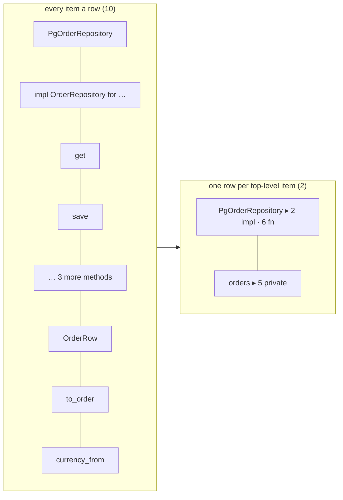

# ADR 0037 · An open area draws one row per top-level item: `impl` blocks and methods fold into their type's row, private loose items into their module's row; a row opens on demand

- Date: 2026-10-21
- Status: accepted
- Source: tau-rs/arch-design#132 (found while defining the V1 lints, #123); makes precise [ADR 0031](0031-items-and-item-ids.md)'s "`impl` blocks … folded under their type on the map"

## In plain words

When you open an area on the map, it shows what is inside it as a list of boxes, one line (a **row**) each. The record said every item is a row, so code written as many small functions opens into a long list: the same logic as ten 6-line helpers is ten rows instead of one. This ADR decides what a row is. A row is one top-level item: a type, a trait, a public function, a module. What an item owns folds into its row as a count you click to open: a type's `impl` blocks and their methods go into the type's row, a trait's methods into the trait's row, and the private helpers that sit loose in a module (functions and types with no `pub` that are not part of a type) go into that module's row. Nothing is hidden for good. A link, a finding or the Reach ring that lands on a folded item lands on its row and says how many. Think of a book's table of contents: chapters are listed, and a chapter opens into its sections when you want them. On the smallsvc golden this takes the `domain` area from 82 rows to 24, `postgres` from 28 to 6, and the whole unit from 286 to 114.

## Context

- Spec §5 / MAP-4: fold, never shrink; above ~80 visible items areas fold to chips with counts. `flows/map-focus.html` (fold state) and `flows/map-real-projects.html` design sub-areas and hierarchical fold (crate → module → item), but `spec/map-invariants.md` puts them in V2 (MAP-8, MAP-27). So in V1 an open area drew every item, one row each.
- [ADR 0031](0031-items-and-item-ids.md): every item rust-analyzer calls an item is an item, methods and `impl` blocks included; an associated item carries `parent` (its `impl` or `trait`); "`impl` blocks are items of kind `impl`, folded under their type on the map". The fact model (tau-rs/arch `schemas/facts.schema.json`) has `parent`, but nothing names an `impl` block's type: no field, and no link (the 9 `implements` links go to the trait).
- `Item.visibility` has five values: `pub` · `crate` (`pub(crate)`) · `super` (`pub(super)`) · `restricted` (`pub(in path)`) · `private` (no modifier). A trait's methods and a trait impl's methods carry `private` because no modifier is written on them: 47 of smallsvc's 64 non-`pub` functions are those. The loose private helpers are 13 functions and 12 types.
- [ADR 0035](0035-what-the-five-lints-check.md): the five lints already give the same result whatever the function size, so only the map was affected.
- Rows an open area draws on the arch-fixtures smallsvc golden (286 items, areas from `repos/smallsvc/.arch/areas.toml`), by rule:

  | area | every item | type fold only | this ADR |
  |---|---:|---:|---:|
  | domain | 82 | 29 | 24 |
  | app | 43 | 22 | 20 |
  | http | 35 | 24 | 23 |
  | ports | 34 | 18 | 18 |
  | postgres | 28 | 13 | 6 |
  | stripe | 13 | 6 | 2 |
  | memory, email, carrier | 20, 9, 7 | 2, 3, 3 | 2, 3, 2 |
  | outside any area (`lib.rs`, `main.rs`, `adapters/mod.rs`) | 15 | 15 | 14 |
  | **unit** | **286** | **135** | **114** |

  With this ADR, 160 of the golden's 976 links end on a folded item and are drawn to its row.

## Decision

| question | answer |
|---|---|
| what a row is | one top-level item of the area: an item with no `parent` that is not folded by the two rules below; a `mod` item is always a row |
| type fold | an `impl` block folds into the row of its type when that type is an item of the same area; a block whose type is elsewhere (smallsvc: `impl From<LineItemDto> for LineItem` in `http`, its type in `domain`) is a row of its own. An associated item folds with its `parent`: an impl's methods into the impl and so into the type's row, a trait's methods into the trait's row |
| what names an `impl` block's type | a new optional field `Item.self_type`: the id of the type the block is for, when that type is an item of the unit; absent otherwise. arch-analyze writes it (tau-rs/arch) |
| module fold | an item with no `parent`, visibility `private`, of any kind but `mod` and `impl`, folds into its module's row, with everything folded into it (a private type's `impl` blocks and methods). When the module's `mod` item is not in the area (the area is that module, or holds a module declared outside it, as `app` holds `config`), the area draws a row for the module that holds only the folded items |
| which visibilities fold | `private` only; `crate`, `super` and `restricted` items stay rows |
| what a row shows | the item, and a count of what is folded into it (for example "▸ 2 impl · 6 fn", "▸ 5 private"); the words and the look are sett's |
| open and closed | every row starts closed, in every area, whatever its size; a person opens it (click, ↩); open rows are remembered per view and per branch, like the level (MAP-5). Opening a row is a fold, like expanding an area: positions in each fold state come from facts only (MAP-1) |
| links | a link whose end is folded is drawn to that end's row; the links between two rows are one link with a count, as between folded chips (MAP-7, read per tau-rs/arch-design#120); links between two items of one closed row are not drawn |
| unresolved paths | a folded item's unresolved paths count on its row's pill, still never merged into resolved links (MAP-16) |
| findings and overlays | a finding on a folded item badges its row (any confidence); sessions, plan and delta paint a row when any item folded into it carries them (MAP-14) |
| Reach | computed on items, unchanged (`reach_depth`); a row is inside the ring when any of its items is, and shows how many ("4 of 5 in reach"); Reach never opens a row (MAP-3) |
| selection and ⌘P | selecting a folded item (on the map, in Files, Ask or Review) selects its row's paint and does not open it (MAP-3); ⌘P ↩ on a folded item opens its row and lands on it, as ↩ opens a level (MAP-10) |
| what counts as a visible item | a row drawn on the map; items folded into a closed row are not visible items, for MAP-4's ~80 threshold and for the 5,000-visible-items budgets ([ADR 0026](0026-budgets-first-index-memory.md)) |
| sub-areas | unchanged: MAP-8 and MAP-27 stay V2 |

Why one row per top-level item: a type's methods and a module's private helpers exist to serve that type or that module, so the row a reader looks for first is the owner, and the count tells them what is inside; this makes the map's length follow the number of things a reader names, not the number of functions the code was cut into.

Why `private` only: a `pub(crate)` or `pub(super)` item is written to be used from another module, so other rows link to it and it belongs on the surface of the list; a `private` item is used only from inside its module.

Why the fold follows the module and not the caller: a private item changes row only when its own visibility or module changes, so an edit somewhere else never moves it (MAP-1, MAP-24).

Why a field for the type: ADR 0031 has consumers read `parent` and never parse an id or a header, and the block's type cannot be read from the facts any other way.

## Consequences

- `spec/arch-v1-spec.md` §5 gains the row rule; `spec/map-invariants.md` gains **MAP-33** with its check; `spec/vocabulary.md` gains **row**.
- tau-rs/arch: `Item.self_type` in `schemas/facts.schema.json` and `docs/arch-facts.md`, written by arch-analyze (optional field, `schema_version` stays 0, as `parent` was added by tau-rs/arch#22); arch-views gives each item its row and each row its counts, and draws links per row.
- tau-rs/arch-fixtures: the smallsvc golden gains `self_type` on its `impl` items; `rows_fold_into_owner` checks MAP-33 (114 rows, per-area counts as above); `visible_items` counts rows.
- tau-rs/sett: the row with its folded count and its open state; the link count between rows; "k of n in reach".
- tau-rs/arch-app: opening and closing a row, remembered per view and per branch; ⌘P ↩ opens the row; a selection from another view does not.
- One honest consequence: a finding on a private helper shows on its module's row, so the reader opens the row to see which helper; the row says how many findings it holds.
- A second: a helper made `pub` leaves its module's row and becomes a row of its own, so the rows below it move down by one; that edit is to the helper itself, never somewhere else.
- A third: a module whose `mod` item sits outside its area (smallsvc: `stripe`, `carrier`, `email`, and `config` inside `app`) gets a row that exists only to hold its private items.
- A fourth: an area of many public functions is still a long list; this ADR folds what an item owns, not public items. Splitting the area, by hand with the area tools (spec §5), or by sub-areas in V2, is the answer there.
- Rejected:
  - Every item a row (the record as written): smallsvc's `domain` opens into 82 rows, more than the ~80 at which the whole map folds.
  - Type fold only: the many-small-functions style moves from methods to free functions and is a long list again (smallsvc: 135 rows).
  - A private helper folds into its only caller: when a second caller appears in another function, the helper and every helper it calls move out of the caller's row, though their code did not change (smallsvc: `to_order` and `currency_from` leave `PgOrderRepository` when `list_by_status` calls `to_order`).
  - Sub-areas (MAP-8, MAP-27) in V1 for areas above ~40 rows: under this ADR no smallsvc area reaches 40 rows, and opening a module chip still draws every item of the module, one row each.
  - A "public items only" filter: a filter is a state that re-lays out the map (MAP-3); a filter that only fades does not shorten the list.
  - Folding `crate`, `super` and `restricted` items with the `private` ones: they are linked to from other modules, so most links into the area would end on module rows.
