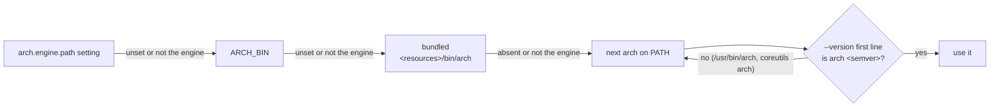

# ADR 0036 · The engine binary stays `arch`: a candidate is the engine only if `--version` prints `arch <semver>` first; the packaged app runs its bundled engine before looking on `PATH`

- Date: 2026-10-21
- Status: accepted
- Source: tau-rs/arch-design#45 (arch-app F-8); amends the packaging line of [ADR 0023](0023-settings-errors-secrets-packaging-telemetry.md)

## In plain words

`arch` is also the name of a system command: macOS ships `/usr/bin/arch` and Linux ships GNU coreutils `arch`. So when the desktop app (arch-app) searched `PATH` for the engine, it found the system command first, ran `/usr/bin/arch serve`, and gave up after five crashes. arch-app has since fixed this: it runs `<candidate> --version` and trusts a candidate only if the first line is `arch <semver>`, and it keeps scanning `PATH` past anything else. The engine already prints that line (`arch 0.1.0`), and tau-rs/arch pins it with a test. This ADR decides the rest of tau-rs/arch-design#45: the engine binary keeps the name `arch`, and a packaged app runs the engine it ships with before it looks on `PATH`. A rename would not have helped: the agent hooks and the MCP server are started by the engine's own absolute path, so the only lookups by name are a person typing `arch` and the app's search, and the app's search no longer needs a unique name. One analogy: two people named Arch in one office; you don't rename one, you ask "which Arch are you?" and check the badge.

## Context

- What each `arch` prints for `--version` (macOS measured on 26.6; coreutils from its standard `--version` format, not run here):

  | candidate | `--version` first line | trusted |
  |---|---|---|
  | `/usr/bin/arch` (macOS) | `arch: Unknown architecture: version`, exit 1 | no |
  | `/usr/bin/arch` (GNU coreutils) | `arch (GNU coreutils) 9.x` | no |
  | the engine, tau-rs/arch main `6db2e74` | `arch 0.1.0` | yes |

- tau-rs/arch: `crates/arch-cli` has `[[bin]] name = "arch"` and `#[command(name = "arch", version, …)]`; `crates/arch-cli/tests/serve.rs` `version_prints_arch_then_semver` pins the first line to `arch <CARGO_PKG_VERSION>` (tau-rs/arch#90). The driver hands Claude Code its hooks and MCP server with the path from `std::env::current_exe()` (`arch-session` `engine.rs`, `ToolLayerArgs.exe`), so the hook command is the engine's absolute path, never a `PATH` lookup ([ADR 0012](0012-confinement-driver-hooks.md)).
- tau-rs/arch-app `packages/arch-shell/src/node/engine-process.ts` `resolveBinary`: the setting `arch.engine.path`, then `ARCH_BIN`, then each `arch` on `PATH`, then the bundled slot `<resources>/bin/arch`; each candidate must match `/^arch\s+v?(\d+\.\d+\.\d+\S*)/` on `--version`. The `PATH` scan skips a candidate that fails and tries the next directory.
- [ADR 0034](0034-arch-api-wire-contract.md) already relies on the line: `initialize.result.engineVersion` is the string `arch --version` prints after `arch `.

## Decision

| question | answer |
|---|---|
| the installed binary's name | `arch` on every platform (`arch.exe` on Windows); no second name, no alias |
| how a program tells the engine from a system `arch` | the first line of `<binary> --version` is `arch <semver>`, the engine's version; anything else is not the engine |
| arch-app's search order | `arch.engine.path` → `ARCH_BIN` → the bundled engine → `PATH`; on `PATH` it skips every candidate that fails the version check |
| how the engine starts its own hooks and MCP server | by its own absolute path (`current_exe`), never by name |
| package names (crate, Homebrew formula) | free to differ from the binary (the crate is already `arch-cli`); not decided here |

Why: the version check already tells the engine from the system command wherever a program looks it up, and nothing else looks it up by name, so a new name would cost every page, command and habit that says `arch` and fix nothing that is still broken.

Why the bundled engine comes before `PATH`: it was built with the app, so its `arch-api` schema matches the app's client ([ADR 0034](0034-arch-api-wire-contract.md) §4), while an `arch` installed on `PATH` months ago may not; the setting and `ARCH_BIN` remain for anyone who wants a different engine. A development build has no bundled engine, so it still finds `arch` on `PATH`.

## Consequences

- tau-rs/arch: nothing left; the line is printed and pinned by tau-rs/arch#90.
- tau-rs/arch-app: `resolveBinary` moves the bundled slot before `PATH`, and the `not-found` message and the `arch.engine.path` description follow the new order (tau-rs/arch-app#31).
- [ADR 0023](0023-settings-errors-secrets-packaging-telemetry.md)'s packaging line points here.
- One honest consequence: a person whose `PATH` lists `/usr/bin` before the directory they installed `arch` into runs the system command when they type `arch check`. It fails loudly, it does not pass silently: macOS answers `arch: Can't find check in PATH` (measured), coreutils answers `arch: extra operand 'check'`. `arch --version` shows which one they have. Homebrew (`/opt/homebrew/bin`), `cargo install` (`~/.cargo/bin`) and GitHub's runners all put their directory before `/usr/bin`, so the default installs are not affected.
- A second: macOS `/usr/bin/arch <name>` runs the program `<name>` found on `PATH`, so a misordered `PATH` plus a program named `init`, `check`, `serve`, `mcp` or `hook` would run that program. arch itself never does this: the app checks `--version` before it runs anything, and the engine starts its hooks by absolute path.
- A third: with the bundled engine first, a user who installs a newer `arch` on `PATH` must set `arch.engine.path` (or `ARCH_BIN`) for the packaged app to use it.
- Rejected:
  - `arch-engine` (or `archd`) as the binary, with `arch` as an alias or symlink: the alias is `arch` again and collides the same way, two names double the install and docs, and `--version` would print a second name that the app's check and ADR 0034's `engineVersion` would also have to accept.
  - A new name with no `arch` at all: every command a person types (`arch init`, `arch check` in CI) and every page and handoff that prints it changes, to fix a lookup the version check already fixes.
  - The packaged app never looks on `PATH`: a developer running the app from source has no bundled engine, and `PATH` after the bundled slot costs nothing once the version check filters it.
