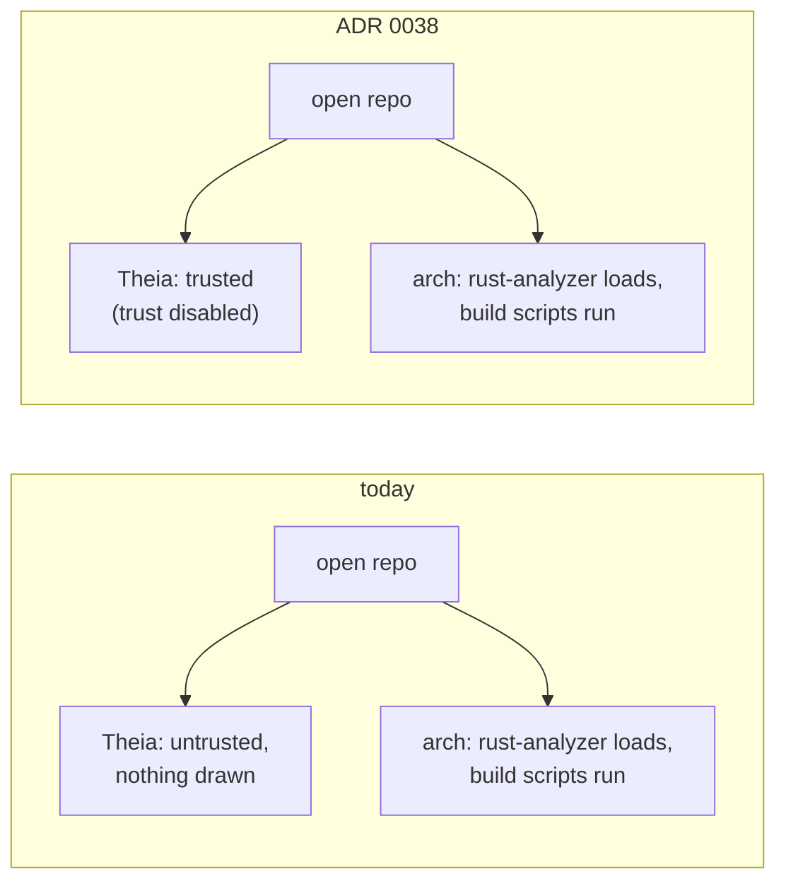

# ADR 0038 · Workspace trust: off in V1; opening a repository in arch is trusting it, as with `cargo build`

- Date: 2026-10-22
- Status: accepted
- Source: tau-rs/arch#115 (arch-app F-16); amends the packaging line of [ADR 0023](0023-settings-errors-secrets-packaging-telemetry.md) and spec §8

## In plain words

Theia, the editor framework arch-app is built on, has a safety lock copied from VS Code: when a folder opens it asks "do you trust the authors of this code?", and until you say yes it runs in **Restricted Mode**, refusing to do things that would execute the folder's code (its tasks, a debugger, extensions). The question is a dialog, and [ADR 0023](0023-settings-errors-secrets-packaging-telemetry.md) forbids dialogs, so arch-app told Theia never to ask. Never answered means no, so every repository opens in Restricted Mode, silently: sett draws the status bar and does not draw Theia's badge.

The lock guards an empty room. arch-app ships none of the Theia packages that consult trust, so Restricted Mode refuses nothing. And the engine ignores the lock: the moment a repository opens, `arch` runs rust-analyzer on it, which runs the repository's build scripts and proc macros; a delegated session later runs `arch check` and the project's tests as gates. arch already treats every opened repository as trusted, the way `cargo build` does. This ADR makes that the stated rule: workspace trust is off, nothing is drawn, and the README says once what opening a repository does. One analogy: a lock on a door with no room behind it, while the back door stands open; we take the lock off and write "the back door is open" on the front.

## Context

- tau-rs/arch-app `applications/electron/package.json` (and the browser target) set `"preferences": { "security.workspace.trust.startupPrompt": "never" }`. Theia 1.76.0 `packages/workspace/src/browser/workspace-trust-service.ts`: with the prompt off and no stored answer, `calculateWorkspaceTrust()` leaves the folder untrusted; the service then calls `showRestrictedModeStatusBarItem()`, which sett's status bar does not render (arch-app F-15, since tau-rs/arch-app#14).
- Theia 1.76.0 `packages/workspace/src/common/workspace-trust-preferences.ts`: `security.workspace.trust.enabled`, default `true`, "If disabled, all workspaces are trusted"; `calculateWorkspaceTrust()` returns `true` first thing when it is `false`, before any prompt.
- Who consults trust in Theia 1.76.0 (code search for `WorkspaceTrustService`): `task`, `debug`, `plugin-ext`, the `ai-*` packages, and `workspace` itself. arch-app depends on `@theia/core · editor · electron · filesystem · markers · messages · monaco · preferences · process · terminal · workspace`: none of the consumers. The trust service also asks `WorkspaceRestrictionContribution`s what Restricted Mode holds back; arch-app binds none, so the list it would show is empty.
- The engine: `crates/arch-analyze` loads rust-analyzer in-process (`ra_ap_load-cargo`, `ra_ap_proc_macro_api`, pinned `0.0.356`) at resolved depth, which runs `cargo metadata`, build scripts and proc macros ([ADR 0010](0010-degrade.md), [ADR 0030](0030-analysis-inputs-outside-the-tree.md)). It starts from `arch serve` with no knowledge of Theia's trust state ([ADR 0034](0034-arch-api-wire-contract.md)). A delegated session's gates run `arch check` and the project's test command (spec §8).
- Coupling with tau-rs/arch#109: the rust-analyzer VS Code extension declares `capabilities.untrustedWorkspaces.supported: false` (`editors/code/package.json`), and Theia's plugin host reads that flag (`plugin-ext` `scanner-theia`, `hosted-plugin`). In an untrusted workspace the extension would never activate.
- V2's plugin system is arch's own: lockfile, acceptance, PLG-1…10 (spec §8, `handoffs/handoff-plugin-system-spec.md`). It does not rely on Theia's workspace trust.

## Decision

| question | answer |
|---|---|
| Theia's workspace trust in V1 | **off**: `security.workspace.trust.enabled: false` in the preferences of both Theia targets; `security.workspace.trust.startupPrompt: never` stays as a second lock, so a Theia upgrade that changes the first key's meaning still cannot open a dialog |
| what is drawn | nothing: no Restricted Mode state in sett's status bar, no "trust this repo" door |
| what is stored | nothing: no per-folder trust record, no `trustedFolders` list |
| what the product says | one sentence in arch-app's README and in `tau-rs/arch` `docs/`: *opening a repository in arch runs its build scripts and proc macros through rust-analyzer, and a delegated session runs `arch check` and the project's test command; open a repository you would `cargo build`* |
| when trust returns | with a feature that would run the repository's code **and** that the engine would also hold back; that is a new ADR, not a setting flip |

Why: a gate the engine does not honour protects nothing; keeping it would show or hide a state that changes no behaviour, which P-2 (state is shown, and shown truthfully) does not allow, and it would silently disable rust-analyzer's hints under one of tau-rs/arch#109's options.

## Consequences

- tau-rs/arch-app: add `"security.workspace.trust.enabled": false` to the `preferences` block of `applications/electron/package.json` and `applications/browser/package.json`; add the trust sentence to the README; FINDINGS.md F-16 → answered; the README's synced-to line moves to this ADR. The issue carries `for:arch-app`.
- tau-rs/arch: `docs/` gains the same sentence where `arch serve` and `arch init` are described.
- [ADR 0023](0023-settings-errors-secrets-packaging-telemetry.md)'s packaging line points here; spec §8 says it in one sentence.
- tau-rs/arch#109 is decided on its own merits: whichever way it goes, Restricted Mode cannot switch the hints off.
- One honest consequence: there is no step between "open" and "run the build". A repository with a hostile `build.rs` runs it when opened in arch, exactly as `cargo build`, `cargo metadata` with build scripts, or rust-analyzer in any editor would. arch adds no exposure that the Rust toolchain does not already have, and it does not pretend to remove one.
- A second: if arch-app later adds a Theia package that consults trust (tasks, debug, `plugin-ext`), it comes in trusted. Adding one means re-reading this ADR, not flipping the preference back.
- Rejected:
  - **Restricted Mode kept and drawn**: a `restricted` pill in sett's status bar and a `trust this repo` door writing `security.workspace.trust.trustedFolders`. Costs sett a state and arch-app a door, for a mode that guards nothing in V1, and sets the tau-rs/arch#109 trap.
  - **The engine honours trust** (do not load rust-analyzer until the user trusts the folder): the only honest version of keeping the lock. It would make the first index wait on a click (against [ADR 0006](0006-arch-init.md), one commit and no questions, and the first-index budget of [ADR 0026](0026-budgets-first-index-memory.md), measured from open), and it would need the trust state carried over `arch-api`, a contract change for a question nobody has asked. Reopen as its own ADR if a user ever asks for it.
