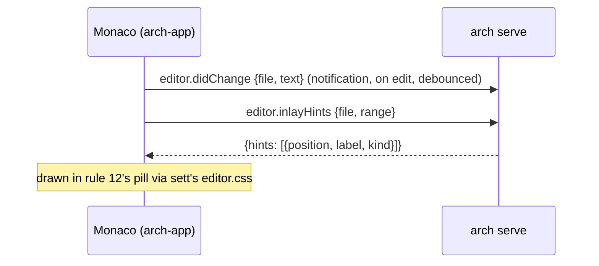

# ADR 0039 · rust-analyzer's hints in the editor pill come from the engine: `editor.inlayHints` and `editor.didChange` on `arch-api`; no Theia extension host, no second rust-analyzer in V1

- Date: 2026-10-23
- Status: accepted
- Source: tau-rs/arch#109 (arch-app F-1); amends spec §6 (daily · read code) and §8; adds the first methods after `initialize` to [ADR 0034](0034-arch-api-wire-contract.md) (schema `0.2.0`)

## In plain words

sett's rule 12 says the code editor shows rust-analyzer's **inlay hints**, the grey annotations such as a variable's inferred type or a parameter's name, in the same small pill that carries counts and blame, without adding a line to the code. In Theia those hints normally arrive the VS Code way: the rust-analyzer extension runs inside Theia's extension host and starts its own rust-analyzer process. arch-app has no extension host, and spec §8 keeps every plugin runtime out of V1.

The engine already runs rust-analyzer. `arch serve` loads the whole repository into rust-analyzer in-process to compute the map, pins the exact library version, and already pushes changed file text into that in-memory view. The same library exposes the inlay-hint function the extension uses. So the pill's hints are one query away: the editor tells the engine what the unsaved buffer says, asks for the hints in the visible range, and draws the answer. One rust-analyzer, one source of truth, no extension host, no extension chrome to suppress, and when rust-analyzer cannot load the repository the hints go away with the resolved facts through the degraded state that already exists ([ADR 0010](0010-degrade.md)). One analogy: the building already has an engineer who knows every pipe; you ask them, rather than hiring a second engineer to stand in the hallway.



## Context

- sett `DESIGN.md` rule 12: "quiet hints in or after the line (counts on the declaration, inline blame on the caret line only, rust-analyzer's hints in the same pill)"; "the editor is Theia's; sett themes it, it does not redraw it". Spec §6 daily · read code: "counts and hints in pills; no inserted lines". arch-app's `arch-editor` package owns gutter marks, hints after the line and underlines (`handoffs/handoff-arch-app.md` §2); milestone 3 is the daily flow live against `arch serve`.
- The engine: `crates/arch-analyze/src/ra.rs` loads rust-analyzer in-process (`ra_ap_ide`, `ra_ap_vfs`, `ra_ap_load-cargo`, pinned `=0.0.356`) and updates it with `Vfs::set_file_contents` followed by `RootDatabase::apply_change` when a file changes. `ra_ap_ide 0.0.356` `Analysis::inlay_hints(&InlayHintsConfig, FileId, Option<TextRange>) -> Cancellable<Vec<InlayHint>>` is the function rust-analyzer's own LSP server calls for `textDocument/inlayHint`.
- `arch-api` ([ADR 0034](0034-arch-api-wire-contract.md)) is at `0.1.0` with `initialize` only; an addition is a minor bump; the engine answers an unknown method with `-32601`, so an older engine degrades to "no hints".
- Theia 1.76.0 ships no language client of its own: `@theia/core` depends on `vscode-languageserver-protocol` for types only, and `@theia/monaco` has no `monaco-languageclient`. A language server reaches the editor through `@theia/plugin-ext` (a VS Code extension) or through code the product writes. Monaco renders inlay hints itself (`languages.registerInlayHintsProvider`); `plugin-ext` is only one caller of it.
- The rust-analyzer VS Code extension declares `untrustedWorkspaces.supported: false`, posts notifications and progress, adds a status item and commands, and downloads its server binary from GitHub on first run. [ADR 0023](0023-settings-errors-secrets-packaging-telemetry.md) forbids modals; P-2 forbids pop-ups and banners; [ADR 0038](0038-workspace-trust-off.md) turned trust off so this option would at least activate.
- Memory: [ADR 0026](0026-budgets-first-index-memory.md) caps the `arch` process at 500 MB RSS; the desktop app has no budget, but a second rust-analyzer on the same repository costs about what the engine's does.

## Decision

| question | answer |
|---|---|
| where the pill's hints come from | the engine's own rust-analyzer, over `arch-api` |
| Theia's extension host (`@theia/plugin-ext`) in V1 | no; spec §8 says so |
| a language client in arch-app | no; arch-app registers a Monaco `InlayHintsProvider` for Rust files that calls the engine |
| what the editor shows in V1 | hints; no completion, no diagnostics, no go-to-definition from rust-analyzer |
| which hints | the kinds and defaults rust-analyzer's own LSP server applies when a client sends no configuration (type, parameter and chaining hints on; the rest as shipped); no settings surface in V1 |
| unsaved text | the editor sends it; the engine answers hints for the buffer as typed; **an unsaved buffer never produces facts** |
| when rust-analyzer cannot load the repository | `hints: []`, no error; the degraded state already says why ([ADR 0010](0010-degrade.md)) |
| schema version | `0.1.0` → `0.2.0` |

### The two additions to `arch-api`

Positions are LSP positions: zero-based `line`, `character` in UTF-16 code units; `file` is the repo-relative path with `/`, as in `facts`. The engine converts from rust-analyzer's byte offsets with its line index; arch-app converts to Monaco's one-based columns.

| | `editor.didChange` | `editor.inlayHints` |
|---|---|---|
| kind | notification, client → engine | request |
| params | `{ "file": string, "text": string \| null }`: the buffer's full text; `null` means the editor closed the file and the disk is the truth again | `{ "file": string, "range": { "start": Position, "end": Position } }` |
| result | none | `{ "hints": InlayHint[] }` |
| `InlayHint` | | `{ "position": Position, "label": string, "kind"?: "type" \| "parameter", "paddingLeft": bool, "paddingRight": bool }`: `kind` is absent for the kinds LSP does not name (chaining, closing brace, …), as rust-analyzer's server does |
| a file the unit does not contain, or not Rust | ignored | `{ "hints": [] }` |
| cadence | on each edit, debounced by the client (a hundred-odd ms; arch-app's call) | when Monaco asks: on edit, scroll, open |

```
→ {"jsonrpc":"2.0","method":"editor.didChange","params":{"file":"src/main.rs","text":"fn main() { let x = 1; }\n"}}
→ {"jsonrpc":"2.0","id":7,"method":"editor.inlayHints","params":{"file":"src/main.rs","range":{"start":{"line":0,"character":0},"end":{"line":1,"character":0}}}}
← {"jsonrpc":"2.0","id":7,"result":{"hints":[{"position":{"line":0,"character":17},"label":": i32","kind":"type","paddingLeft":false,"paddingRight":false}]}}
```

Facts stay facts. Full text rather than deltas because `Vfs::set_file_contents` takes the whole file and the editor has it. The rule the engine must keep, however it keeps it: a save of file B while file A has unsaved text yields the same facts as with no editor open. The test is named `unsaved_buffer_changes_no_facts`. The mechanism (a second snapshot for editor queries, or re-applying the disk text before a facts pass) is the engine's.

Why: the hints the pill wants are already computed on this machine, for this repository, by a rust-analyzer the engine loads and keeps current; a second one would double the memory and the load time to reach the same answer, and the extension that would start it brings an extension host and a layer of chrome the product forbids.

## Consequences

- tau-rs/arch: `editor.didChange` and `editor.inlayHints` in `schemas/arch-api.json` at `0.2.0`, served by `arch serve`, with `unsaved_buffer_changes_no_facts`: tau-rs/arch#192, needed before arch-app milestone 3's editor pill.
- tau-rs/arch-app (`for:arch-app`): regenerate `arch-client` at `0.2.0`; `arch-editor` registers a Monaco `InlayHintsProvider` for Rust models that sends `editor.didChange` on content change and asks `editor.inlayHints` for the visible range; the hint is drawn with sett's `editor.css` classes in rule 12's pill. No `@theia/plugin-ext`, no `@theia/plugin-ext-vscode`. FINDINGS.md F-1 → answered.
- [ADR 0034](0034-arch-api-wire-contract.md): these are the first methods after `initialize`; they are editor-only and are never served over MCP, so §5's open question (the app method set over MCP) stays open for the view methods.
- Spec §6 and §8 cite this ADR; spec §8 now also says Theia's extension host is out of V1.
- A push event when the analyzer reloads or degrades (so hints refresh without an edit) is not added here; it comes with the analyzer's state events in ADR 0034's slice (c). Until then Monaco re-asks on the next edit or scroll.
- One honest consequence: V1's "edit by hand" editor has hints but no completion and no red squiggles from rust-analyzer. If arch is to be a place where someone writes Rust for an hour, that is a new decision (the extension host, with its chrome tamed), not a flip of this one.
- A second: a hint request after an edit re-type-checks the file in the engine, the same cost rust-analyzer pays in any editor, now inside the `arch` process. The 500 MB budget ([ADR 0026](0026-budgets-first-index-memory.md)) is unchanged and still measured on the engine alone; a new budget for hint latency is not set here.
- Rejected:
  - **Theia's extension host for the one extension**: a full Rust IDE (completion, diagnostics, go-to-definition) at the price of `@theia/plugin-ext`, a second rust-analyzer, a server download on first run, and the extension's notifications, progress, status item and commands, each one a P-2 violation to suppress one by one. It also disagrees with spec §8's "no plugin host" in spirit, if not in letter.
  - **A language client written in arch-app**: spawns and owns a rust-analyzer binary, speaks LSP for hints only; costs the second process like the extension and gives only what the engine already has; new code with a scope that only grows ("just add completion").
